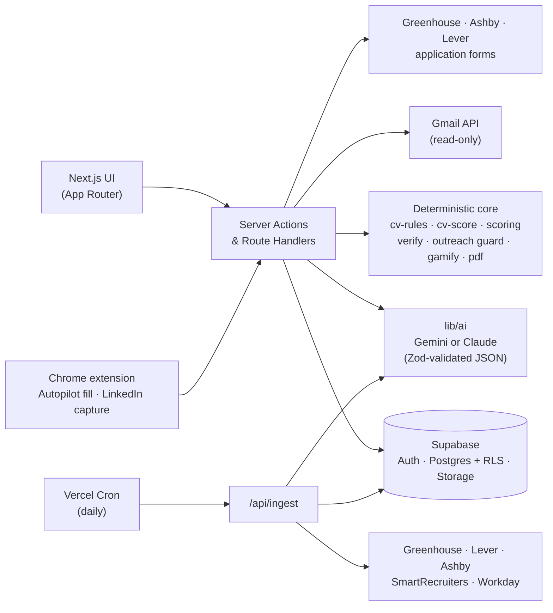

<div align="center">

<picture>
  <source media="(prefers-color-scheme: dark)" srcset="docs/readme/banner-dark.png">
  
</picture>

<br><br>

**The internship co-pilot for UK students: honest about your CV, and it never makes anything up.**

Find live internships, spring weeks and placements. Score your CV and LinkedIn against cited, sector-specific rules.
Tailor your CV to a job without inventing a single claim. Let Autopilot fill the application form, then press *Submit* yourself.
Track every application, prep for the interview, and reach out to the right people.

**[Try it live → placed-lovat.vercel.app](https://placed-lovat.vercel.app)** · no sign-up needed to start

<p>
  
  
  
  
  
  
  
  
  <a href="LICENSE"></a>
  
</p>

<sub>Built at the UCL hackathon, October 2026 · theme: <i>"How can we make students' lives easier?"</i></sub>

<p>
  <a href="#features">Features</a> ·
  <a href="#-autopilot-fill-the-form-never-submit-it">Autopilot</a> ·
  <a href="#a-quick-tour">Tour</a> ·
  <a href="#principles">Principles</a> ·
  <a href="#architecture">Architecture</a> ·
  <a href="#getting-started">Getting started</a>
</p>

</div>

---

## Why Placed?

Students hunting for internships run into the same four walls:

| The problem | What Placed does |
|---|---|
| "I don't know which roles I'm a fit for." | A short quiz or a CV upload maps you to **role archetypes** and explains why each one fits. |
| Openings are scattered across dozens of career sites. | A daily ingest pulls **live roles from 160+ employers** through public ATS APIs and ranks them by fit. |
| Tailoring a CV for every application is exhausting. | **One-click tailoring**, checked line by line in code so nothing is fabricated. |
| Every form asks the same 30 questions again. | **Autopilot** fills Greenhouse, Ashby and Lever forms from answers you gave once, and stops at *Submit*. |
| Recruiter emails get lost and the tracker goes stale. | The **Inbox Agent** reads your job emails (read-only) and moves tracker cards forward, with the evidence. |
| You don't know what the interview will ask. | **Interview prep** built from real candidate reports, each one linked to its source. |
| The whole process is lonely and demotivating. | A tracker with **XP, levels, streaks and badges**, including one for applying again after a rejection. |

## Features

### 🎯 CV Score with citations
Your CV is scored against **160+ rules** for Finance, Consulting, Tech, Product and Data. Each rule links to its published source and carries an evidence grade (A–D). Rules backed only by convention are labelled as convention and count for less. A *Myth vs evidence* card debunks popular CV advice that the evidence doesn't support.

<p align="center"></p>

### 🔎 Live, ranked internship feed
Jobs come straight from **Greenhouse, Lever, Ashby, SmartRecruiters and Workday** boards. No scraping of LinkedIn or login-walled portals. A rule-based fit score handles the eligibility checks that usually rule students out (year of study, graduation date, visa/right to work, location) **before** any AI is involved, so the feed ranks instantly and costs nothing per view.

<p align="center"></p>

### ✍️ Tailoring that never fabricates
> *Keywords get reformulated, never fabricated.*

Tailoring may reorder, rephrase and emphasise. A deterministic verifier (`lib/verify`) rejects any new skill, number, employer, title or tool that isn't in your original CV. When a line would be stronger with a figure, Placed leaves a blank (`[add your real number]`) instead of guessing. You see exactly which job requirements the CV was tailored against and which rules it now satisfies, and you download an ATS-safe PDF.

<p align="center"></p>

<table>
  <tr>
    <td width="40%" valign="top"></td>
    <td width="60%" valign="top">
      <h4>What the verifier caught here</h4>
      <p>The model suggested two lines the CV couldn't back up:</p>
      <ul>
        <li><b>An invented number.</b> "Reduced regressions by 20%" appears nowhere in the original. Placed removes it and asks the student to confirm the real figure.</li>
        <li><b>A swapped tool.</b> "Ran the script on Azure" when the CV says AWS. Placed restores the student's own wording.</li>
        <li><b>A missing requirement stays missing.</b> "Case interviews" is marked as not on the CV, with advice on how to close the gap, instead of being slipped in.</li>
      </ul>
      <p>Every accepted line links back to the sentence in the original CV it came from.</p>
    </td>
  </tr>
</table>

### 🧭 Target Role mode
Pick the role you want. Placed shows what the market asks for, your readiness percentage, and a **cited Role Playbook** of projects, free courses, experiences and employer signals that close the gap. Nothing goes onto your CV until you confirm it.

<p align="center"></p>

### 🤖 Autopilot: fill the form, never submit it
Placed reads the employer's application form through public **Greenhouse, Ashby and Lever** APIs and builds an *Application Pack*: every field, matched to your answers. Press **Open & fill** and the Placed Chrome extension fills the real page, outlines each field it touched (green = filled, amber = your call) and **stops at *Submit***.

- **Answer once, reuse forever.** Every short answer is remembered for later applications. An exact match fills itself; a near-identical question is pre-selected for one-click confirmation.
- **Suggestions only with evidence.** AI pre-fills an unanswered question only when your CV backs it up, and every suggestion waits for your *Confirm*.
- **Hard red lines.** Right to work and sponsorship always come from your own answer, diversity (EEO) questions are never filled or stored, and free-text answers go through the same no-fabrication verifier as tailoring.
- Your vault (email, phone, right to work) is **encrypted at rest** with AES-GCM.

### 🔗 LinkedIn score
One click in the Chrome extension captures your own LinkedIn profile and scores it against **140+ cited rules**, framed as *how you come across when a recruiter looks you up*. Photo, connection count and posting frequency carry zero weight, and the critical rules check that your LinkedIn and CV tell the same story.

### 🎤 Interview prep
Once you've applied, Placed builds a prep pack for that company and role from real candidate reports (Reddit, Wall Street Oasis and similar), found with grounded search. Each likely question links to its source, and Placed maps it to a story from your own CV.

### 📬 Inbox Agent and networking
- **Inbox Agent.** Connect Gmail with a read-only scope. Placed classifies job emails and moves tracker cards *forward only*, showing the email it acted on, with one-click undo and deadline chips. The refresh token is encrypted at rest.
- **Networking.** For each target employer, Placed suggests who to look up (plain LinkedIn search links, no scraping) and drafts an outreach message. A deterministic guard blocks any claim about you or the firm that it can't back up. Tracker nudges remind you to prep and to follow up after 21 days.

### 🏆 Tracker and gamification
A kanban from Saved → Applied → Interview → Offer / Rejected, with levels (*Explorer → Applicant → Contender → Shortlisted → Placed*) and badges such as **Early Bird**, **Spring Week Hunter**, **Made it yours** and **Bounce Back**. XP rewards well-matched applications, not volume.

<p align="center"></p>

## A quick tour

The demo walks through one fictional student, **Ayşe Demir**, a 2nd-year Economics student at UCL, applying to a real, unedited posting:

1. **Start in 20 seconds, no account needed.** Pick your year, field and location with a few taps; save an account at the end if you want to keep your progress.
2. **Drop in your CV.** Placed scores it for your target sector and shows the single most valuable fix, with its source.
3. **Switch sector.** Rescore for Consulting and the advice changes, because each sector has its own rules.
4. **Open a job.** See which must-haves you meet, why you fit, and what's missing.
5. **Tailor.** Get a version of your CV for this job. Unsupported claims are caught and a blank is left where only you know the real number.
6. **Autopilot.** Open the employer's form; the extension fills it from your pack and stops at *Submit*. You check it and press the button.
7. **Track and prep.** The application lands in the tracker, your first badge unlocks, and an interview prep pack is one click away.

## Principles

These rules are enforced in code, not just written down.

1. **Never fabricate.** Every claim in a tailored CV must trace back to the original CV or to something the student explicitly confirmed.
2. **Never apply on the student's behalf.** Autopilot fills forms but never presses *Submit*, and the APIs it reads from can't submit either. The student always presses the button.
3. **Job text is data, not instructions.** Postings reach the model inside `<job_posting>` tags and are treated as untrusted input, which blocks prompt injection.
4. **Evidence-honest scoring.** Every rule cites its source and evidence grade, and sector weightings are documented as a synthesis rather than presented as an official rubric.
5. **Fair by design.** The CV scorer never sees your name, email, address, photo, nationality or date of birth.
6. **Your data stays yours.** CVs live in private storage behind row-level security, Gmail tokens and the Autopilot vault are encrypted at rest, Gmail access is read-only, and *Delete my data* removes everything for good.
7. **Hardened inputs.** Login and save routes are rate-limited, and user input is sanitised before it reaches a database filter.

## Architecture



**Cost-aware AI.** Each job is tagged **once**, at ingest, by the fast model, and the result is cached. Feed ranking is pure TypeScript. The smart model only runs when a student opens a job, scores a CV or asks for tailoring, and those results are cached too. Every model call returns schema-validated JSON, and `AI_MODE=fixture` runs the whole app offline on hand-labelled fixtures.

## Tech stack

| Layer | Choice |
|---|---|
| Frontend | Next.js 16 (App Router), React 19, Tailwind CSS 4, shadcn/ui, Motion |
| Backend | Server Actions, Route Handlers, Vercel Cron |
| Data | Supabase Auth (guest start, email + password, magic link, Google), Postgres with RLS, private Storage |
| AI | Google GenAI (`gemini-3.8-flash`, with search grounding for interview prep) or Anthropic SDK (`claude-sonnet-5-5`, `claude-haiku-4-5`), behind an `AI_PROVIDER` switch |
| Extension | Chrome MV3: Autopilot form filler and one-click LinkedIn capture |
| PDF | `@react-pdf/renderer` (serverless-safe, no headless Chromium) |
| Security | AES-GCM encryption for Gmail tokens and the Autopilot vault, rate-limited auth routes, PostgREST filter-injection lint |
| Quality | Vitest (150+ test files, including fairness and security suites), Playwright end-to-end runs, Zod everywhere |

## Getting started

### Prerequisites

- Node.js 22+
- A [Supabase](https://supabase.com) project
- An Anthropic **or** Gemini API key (optional: fixture mode needs neither)

### Setup

```bash
git clone https://github.com/berkeaskim/placed.git
```

```bash
cd placed && npm install
```

```bash
cp .env.example .env.local
```

Fill in `.env.local`:

| Variable | Purpose |
|---|---|
| `NEXT_PUBLIC_SUPABASE_URL`, `NEXT_PUBLIC_SUPABASE_ANON_KEY` | Supabase client |
| `SUPABASE_SERVICE_ROLE_KEY` | Server-only writes (XP, ingest, tailored PDFs) |
| `AI_PROVIDER` | `anthropic` or `gemini` |
| `ANTHROPIC_API_KEY` / `GEMINI_API_KEY` | Key for the provider you picked |
| `AI_MODE` | `fixture` to run offline on hand-labelled outputs |
| `CRON_SECRET` | Protects `/api/ingest` |
| `NEXT_PUBLIC_DEMO_MODE`, `DEMO_EMAIL`, `DEMO_PASSWORD` | Optional one-click demo account |
| `GOOGLE_CLIENT_ID`, `GOOGLE_CLIENT_SECRET` | Read-only Gmail connection for the Inbox Agent |
| `GMAIL_TOKEN_KEY` | 32-byte key that encrypts stored Gmail refresh tokens (`openssl rand -base64 32`) |
| `VAULT_ENC_KEY` | 32-byte key that encrypts the Autopilot vault (`openssl rand -base64 32`) |
| `NEXT_PUBLIC_AUTOPILOT` | `1` to turn on Autopilot |

Apply the SQL files in [`supabase/migrations`](supabase/migrations) to your project in order, then seed jobs and start the app:

```bash
npm run seed
```

```bash
npm run dev
```

Open <http://localhost:3000>.

To try Autopilot or LinkedIn capture locally, load the [`extension/`](extension) folder unpacked in `chrome://extensions` (see [`extension/README.md`](extension/README.md)).

### Useful scripts

| Command | What it does |
|---|---|
| `npm run ingest` | Pull fresh jobs from every configured ATS board |
| `npm run snapshot` | Save live jobs to `seed/jobs.json` for offline demos |
| `npm test` | Unit tests (Vitest) |
| `npm run e2e` | End-to-end demo run (Playwright) |
| `npm run typecheck` | Type-check the project |
| `npm run demo:user` / `demo:reset` | Create or reset the fictional demo student (live demo on prod: needs `PLACED_ALLOW_LIVE_DEMO_WRITE=1` and Berke's OK) |

## Project structure

```
app/                 Pages: feed, jobs/[id], profile (score · quiz · target · linkedin), tracker, autopilot, settings
extension/           Chrome MV3 extension: Autopilot form filler + LinkedIn capture
lib/
  ai/                Model calls: parseCV, tagJob, judgeCvRules, explainMatch, tailorCV, draftOutreach …
  autopilot/         Form readers (Greenhouse · Ashby · Lever), answer vault, remembered answers
  linkedin-score/    LinkedIn rules + scoring
  interview-prep/    Grounded prep packs with sources, cached per company and role
  inbox/, gmail/     Read-only Gmail sync and email → tracker classification
  outreach/          Networking targets + anti-fabrication guard for outreach drafts
  cv-rules/          Cited rule library + sector profiles (data, not prompts)
  cv-score/          Deterministic checks + aggregation into the CV Score
  ingest/            ATS providers, title/location filters, dedupe, liveness
  scoring/           Student × job fit: eligibility gates, keyword coverage, 1–5 score
  verify/            Anti-fabrication verifier for tailored CVs
  gamify/            XP, levels, streaks, badges (service-role only)
  pdf/               ATS-safe CV renderer
seed/                Employer list (companies.yml), job snapshot, fictional demo persona
supabase/            SQL migrations
docs/research/       Sources behind every CV rule and Role Playbook
```

## Roadmap

- [x] **Placed Autopilot:** read application forms through public ATS APIs and fill them from a one-time answer vault with a Chrome extension. It always stops at *Submit*.
- [x] Interview prep grounded in real candidate reports
- [x] LinkedIn score, Inbox Agent and networking
- [ ] Autopilot on the Chrome Web Store
- [ ] More employer coverage (JPMorgan, Goldman Sachs, the Big Four and other bank and Workday portals)
- [ ] Cover letters that follow the same no-fabrication rules

## Acknowledgements

- The scoring, triage and tailoring logic is adapted from **career-ops** (MIT), a single-user CLI for job searching that Placed turns into a product for students.
- CV rules and Role Playbooks are built from published recruiter, university careers-service and employer sources, all listed in [`docs/research`](docs/research).

## License

Released under the [MIT License](LICENSE).

---

<div align="center">
<sub>Made in London by <a href="https://github.com/berkeaskim">Berke</a> with Claude.</sub>
</div>
