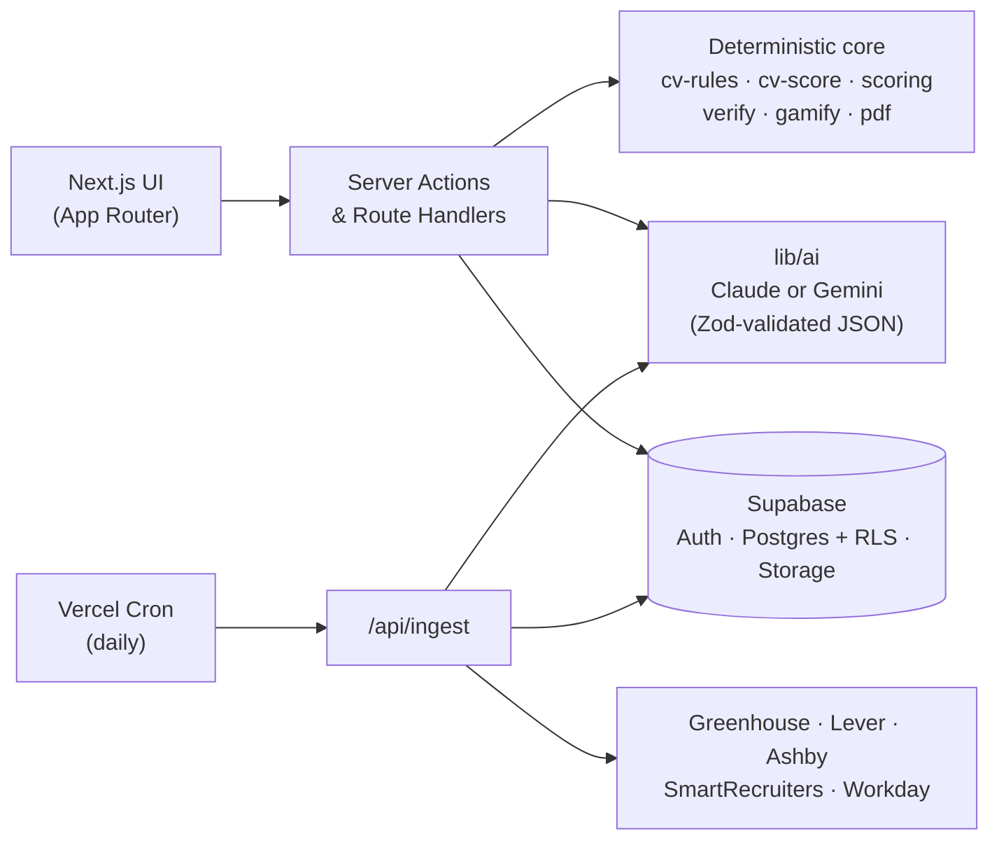

<div align="center">

# Placed

**The internship co-pilot for UK students: honest about your CV, and it never makes anything up.**

Find live internships, spring weeks and placements. Score your CV against cited, sector-specific rules.
Tailor it to a job without inventing a single claim. Track every application.

<p>
  
  
  
  
  
  
  
  
</p>

<sub>Built at the UCL hackathon, October 2026 · theme: <i>"How can we make students' lives easier?"</i></sub>

</div>

---

## Why Placed?

Students hunting for internships run into the same four walls:

| The problem | What Placed does |
|---|---|
| "I don't know which roles I'm a fit for." | A short quiz or a CV upload maps you to **role archetypes** and explains why each one fits. |
| Openings are scattered across dozens of career sites. | A daily ingest pulls **live roles from 160+ employers** through public ATS APIs and ranks them by fit. |
| Tailoring a CV for every application is exhausting. | **One-click tailoring**, checked line by line in code so nothing is fabricated. |
| The whole process is lonely and demotivating. | A tracker with **XP, levels, streaks and badges**, including one for applying again after a rejection. |

## Features

### 🎯 CV Score with citations
Your CV is scored against **160+ rules** for Finance, Consulting, Tech, Product and Data. Each rule links to its published source and carries an evidence grade (A–D). Rules backed only by convention are labelled as convention and count for less. A *Myth vs evidence* card debunks popular CV advice that the evidence doesn't support.

### 🔎 Live, ranked internship feed
Jobs come straight from **Greenhouse, Lever, Ashby, SmartRecruiters and Workday** boards. No scraping of LinkedIn or login-walled portals. A rule-based fit score handles the eligibility checks that usually rule students out (year of study, graduation date, visa/right to work, location) **before** any AI is involved, so the feed ranks instantly and costs nothing per view.

### ✍️ Tailoring that never fabricates
> *Keywords get reformulated, never fabricated.*

Tailoring may reorder, rephrase and emphasise. A deterministic verifier (`lib/verify`) rejects any new skill, number, employer, title or tool that isn't in your original CV. When a line would be stronger with a figure, Placed leaves a blank (`[add your real number]`) instead of guessing. You see exactly which job requirements the CV was tailored against and which rules it now satisfies, and you download an ATS-safe PDF.

### 🧭 Target Role mode
Pick the role you want. Placed shows what the market asks for, your readiness percentage, and a **cited Role Playbook** of projects, free courses, experiences and employer signals that close the gap. Nothing goes onto your CV until you confirm it.

### 🏆 Tracker and gamification
A kanban from Saved → Applied → Interview → Offer / Rejected, with levels (*Explorer → Applicant → Contender → Shortlisted → Placed*) and badges such as **Early Bird**, **Spring Week Hunter**, **Made it yours** and **Bounce Back**. XP rewards well-matched applications, not volume.

## Principles

These rules are enforced in code, not just written down.

1. **Never fabricate.** Every claim in a tailored CV must trace back to the original CV or to something the student explicitly confirmed.
2. **Never apply on the student's behalf.** Placed links to the employer's own page. The student presses *Apply*.
3. **Job text is data, not instructions.** Postings reach the model inside `<job_posting>` tags and are treated as untrusted input, which blocks prompt injection.
4. **Evidence-honest scoring.** Every rule cites its source and evidence grade, and sector weightings are documented as a synthesis rather than presented as an official rubric.
5. **Fair by design.** The CV scorer never sees your name, email, address, photo, nationality or date of birth.
6. **Your data stays yours.** CVs live in private storage behind row-level security, and *Delete my data* removes them for good.

## Architecture



**Cost-aware AI.** Each job is tagged **once**, at ingest, by the fast model, and the result is cached. Feed ranking is pure TypeScript. The smart model only runs when a student opens a job, scores a CV or asks for tailoring, and those results are cached too. Every model call returns schema-validated JSON, and `AI_MODE=fixture` runs the whole app offline on hand-labelled fixtures.

## Tech stack

| Layer | Choice |
|---|---|
| Frontend | Next.js 16 (App Router), React 19, Tailwind CSS 4, shadcn/ui, Motion |
| Backend | Server Actions, Route Handlers, Vercel Cron |
| Data | Supabase Auth (magic link + Google), Postgres with RLS, private Storage |
| AI | Anthropic SDK (`claude-sonnet-5-5`, `claude-haiku-4-5`) or Google GenAI (`AI_PROVIDER` switch) |
| PDF | `@react-pdf/renderer` (serverless-safe, no headless Chromium) |
| Quality | Vitest (100 test files, including a fairness suite), Playwright end-to-end demo run, Zod everywhere |

## Getting started

### Prerequisites

- Node.js 22+
- A [Supabase](https://supabase.com) project
- An Anthropic **or** Gemini API key (optional: fixture mode needs neither)

### Setup

```bash
git clone https://github.com/berkeaskim/placed.git
```

```bash
cd placed && npm install
```

```bash
cp .env.example .env.local
```

Fill in `.env.local`:

| Variable | Purpose |
|---|---|
| `NEXT_PUBLIC_SUPABASE_URL`, `NEXT_PUBLIC_SUPABASE_ANON_KEY` | Supabase client |
| `SUPABASE_SERVICE_ROLE_KEY` | Server-only writes (XP, ingest, tailored PDFs) |
| `AI_PROVIDER` | `anthropic` or `gemini` |
| `ANTHROPIC_API_KEY` / `GEMINI_API_KEY` | Key for the provider you picked |
| `AI_MODE` | `fixture` to run offline on hand-labelled outputs |
| `CRON_SECRET` | Protects `/api/ingest` |
| `NEXT_PUBLIC_DEMO_MODE`, `DEMO_EMAIL`, `DEMO_PASSWORD` | Optional one-click demo account |

Apply the SQL files in [`supabase/migrations`](supabase/migrations) to your project in order, then seed jobs and start the app:

```bash
npm run seed
```

```bash
npm run dev
```

Open <http://localhost:3000>.

### Useful scripts

| Command | What it does |
|---|---|
| `npm run ingest` | Pull fresh jobs from every configured ATS board |
| `npm run snapshot` | Save live jobs to `seed/jobs.json` for offline demos |
| `npm test` | Unit tests (Vitest) |
| `npm run e2e` | End-to-end demo run (Playwright) |
| `npm run typecheck` | Type-check the project |
| `npm run demo:user` / `demo:reset` | Create or reset the fictional demo student |

## Project structure

```
app/                 Pages: feed, jobs/[id], profile (score · quiz · target), tracker, settings
lib/
  ai/                Model calls: parseCV, tagJob, judgeCvRules, explainMatch, tailorCV …
  cv-rules/          Cited rule library + sector profiles (data, not prompts)
  cv-score/          Deterministic checks + aggregation into the CV Score
  ingest/            ATS providers, title/location filters, dedupe, liveness
  scoring/           Student × job fit: eligibility gates, keyword coverage, 1–5 score
  verify/            Anti-fabrication verifier for tailored CVs
  gamify/            XP, levels, streaks, badges (service-role only)
  pdf/               ATS-safe CV renderer
seed/                Employer list (companies.yml), job snapshot, fictional demo persona
supabase/            SQL migrations
docs/research/       Sources behind every CV rule and Role Playbook
```

## Roadmap

- [ ] **Placed Autopilot:** read application forms through public ATS APIs and pre-fill them from a one-time answer vault with a Chrome extension. It always stops at *Submit*.
- [ ] More employer coverage (Oracle and other bank and Big Four portals)
- [ ] Interview prep and cover letters that follow the same no-fabrication rules

## Acknowledgements

- The scoring, triage and tailoring logic is adapted from **career-ops** (MIT), a single-user CLI for job searching that Placed turns into a product for students.
- CV rules and Role Playbooks are built from published recruiter, university careers-service and employer sources, all listed in [`docs/research`](docs/research).

## License

No license has been chosen yet. Until one is added, all rights are reserved. An open-source license is planned.

---

<div align="center">
<sub>Made in London by <a href="https://github.com/berkeaskim">Berke</a> with Claude.</sub>
</div>
