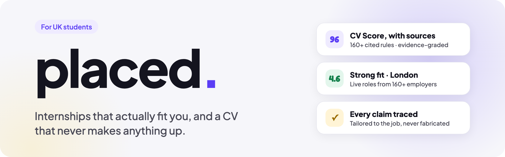
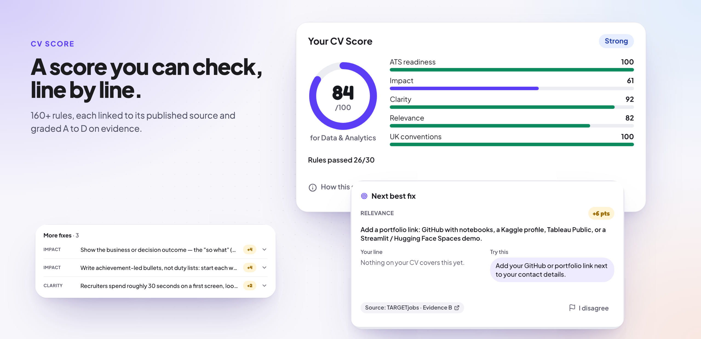
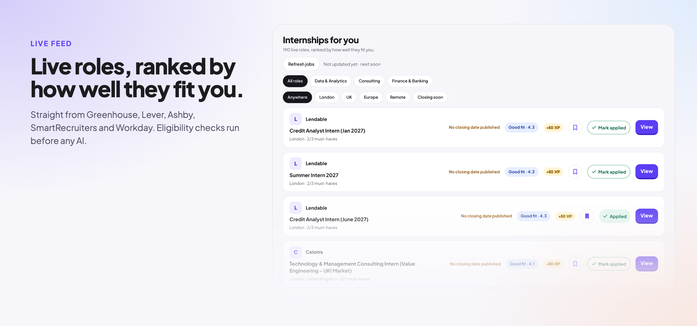
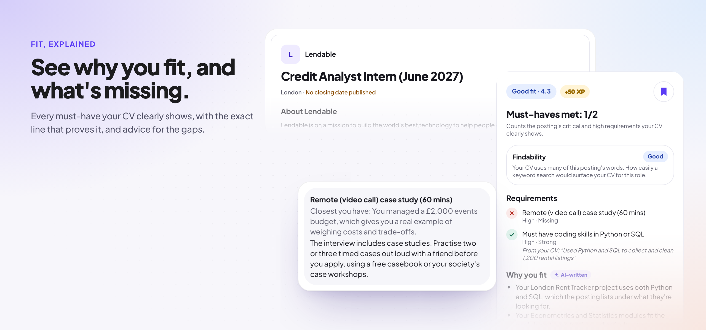
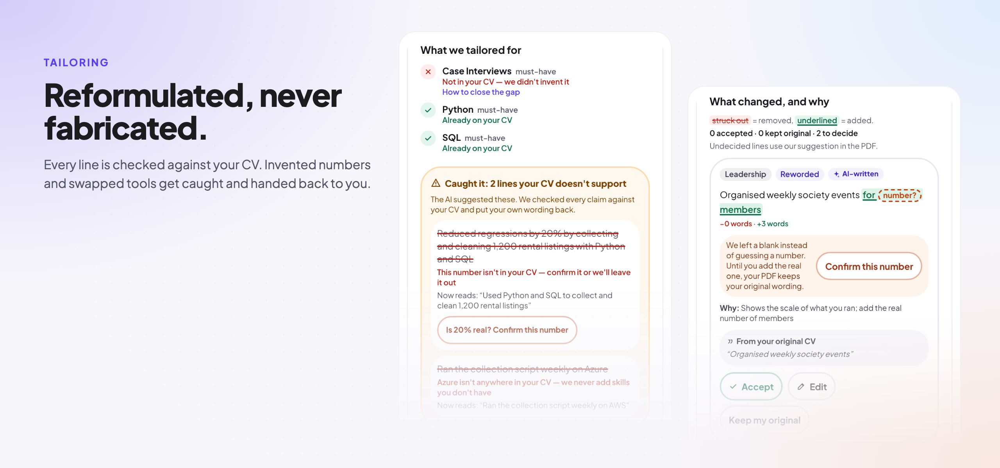
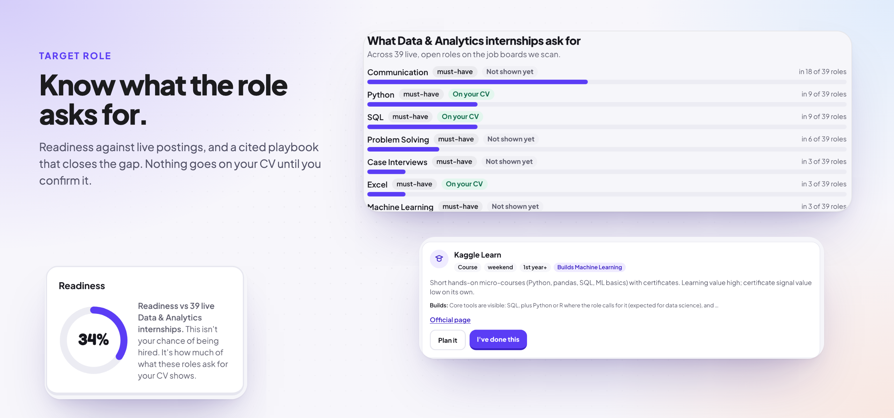
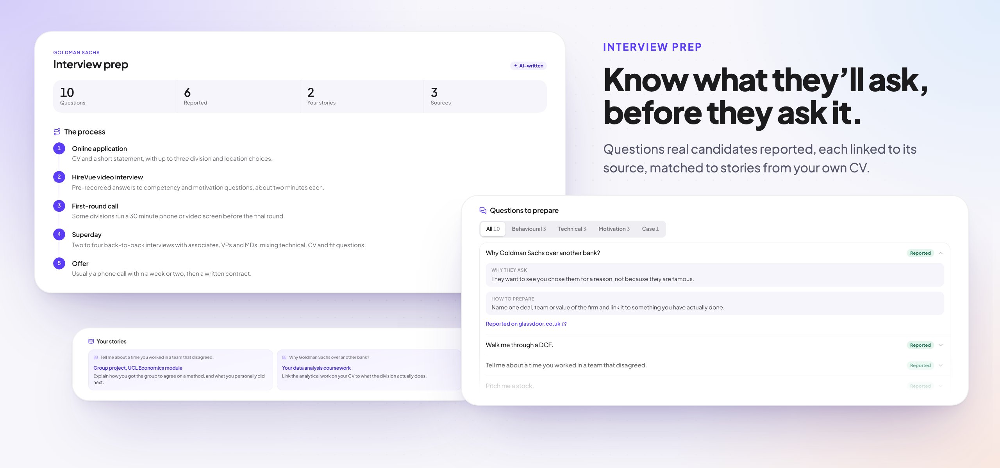
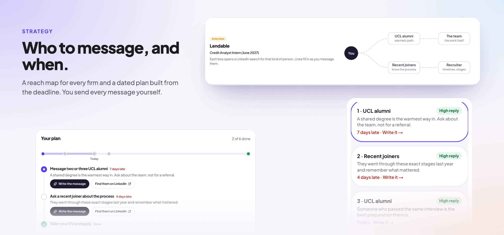
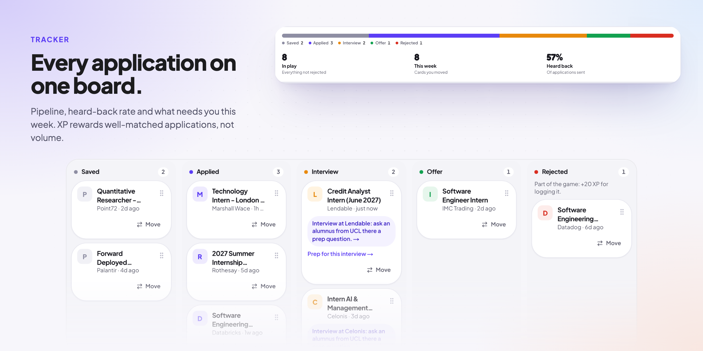
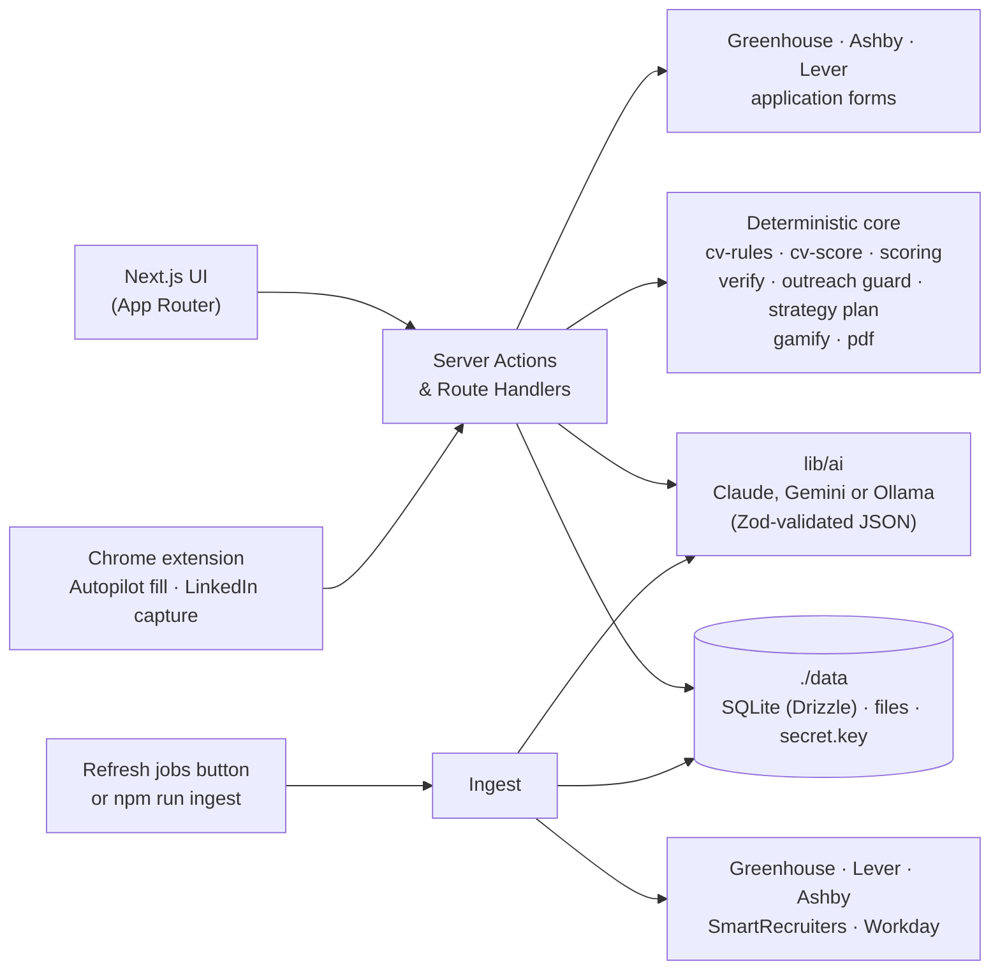

<div align="center">

<picture>
  <source media="(prefers-color-scheme: dark)" srcset="docs/readme/banner-dark.png">
  
</picture>

<br><br>

**The internship co-pilot for UK students: honest about your CV, and it never makes anything up.**

Find live internships, spring weeks and placements. Score your CV and LinkedIn against cited, sector-specific rules.
Tailor your CV to a job without inventing a single claim. Let Autopilot fill the application form, then press *Submit* yourself.
Track every application, prep for the interview, and get a dated plan for who to message and when.

**Runs on your own computer.** No account, no cloud database: your CV and applications stay in a folder on your machine.
Bring a Claude or Gemini key, or run a model locally with Ollama.

<p>
  
</p>

<p>
  
  
  
  
  
  
  
  
  
  <a href="LICENSE"></a>
  
</p>

<sub>🥉 <b>3rd place at the Claude Hackathon</b> at UCL, October 2026 · theme: <i>"How can we make students' lives easier?"</i></sub>

<p>
  <a href="#features">Features</a> ·
  <a href="#-autopilot-fill-the-form-never-submit-it">Autopilot</a> ·
  <a href="#a-quick-tour">Tour</a> ·
  <a href="#principles">Principles</a> ·
  <a href="#architecture">Architecture</a> ·
  <a href="#quick-start">Quick start</a> ·
  <a href="#choosing-an-ai-backend">AI backend</a> ·
  <a href="#troubleshooting">Troubleshooting</a>
</p>

</div>

---

## Why Placed?

Students hunting for internships run into the same four walls:

| The problem | What Placed does |
|---|---|
| "I don't know which roles I'm a fit for." | A short quiz or a CV upload maps you to **role archetypes** and explains why each one fits. |
| Openings are scattered across dozens of career sites. | One click on **Refresh jobs** pulls **live roles from 160+ employers** through public ATS APIs and ranks them by fit. |
| Tailoring a CV for every application is exhausting. | **One-click tailoring**, checked line by line in code so nothing is fabricated. |
| Every form asks the same 30 questions again. | **Autopilot** fills Greenhouse, Ashby and Lever forms from answers you gave once, and stops at *Submit*. |
| You don't know who to talk to, or when. | A **Strategy** tab maps the people worth reaching at each firm and turns your deadline into a dated plan. |
| You don't know what the interview will ask. | **Interview prep** built from real candidate reports, each one linked to its source. |
| The whole process is lonely and demotivating. | A tracker with **XP, levels, streaks and badges**, including one for applying again after a rejection. |

## Features

### 🎯 CV Score with citations
Your CV is scored against **160+ rules** for Finance, Consulting, Tech, Product and Data. Each rule links to its published source and carries an evidence grade (A–D). Rules backed only by convention are labelled as convention and count for less. A *Myth vs evidence* card debunks popular CV advice that the evidence doesn't support.

<p align="center"></p>

### 🔎 Live, ranked internship feed
Jobs come straight from **Greenhouse, Lever, Ashby, SmartRecruiters and Workday** boards. No scraping of LinkedIn or login-walled portals. A rule-based fit score handles the eligibility checks that usually rule students out (year of study, graduation date, visa/right to work, location) **before** any AI is involved, so the feed ranks instantly and costs nothing per view.

<p align="center"></p>

### ✍️ Tailoring that never fabricates
> *Keywords get reformulated, never fabricated.*

Tailoring may reorder, rephrase and emphasise. A deterministic verifier (`lib/verify`) rejects any new skill, number, employer, title or tool that isn't in your original CV. When a line would be stronger with a figure, Placed leaves a blank (`[add your real number]`) instead of guessing. You see exactly which job requirements the CV was tailored against and which rules it now satisfies, and you download an ATS-safe PDF.

<p align="center"></p>

<p align="center"></p>

**What the verifier caught here.** The model suggested two lines the CV couldn't back up:

- **An invented number.** "Reduced regressions by 20%" appears nowhere in the original. Placed removes it and asks the student to confirm the real figure.
- **A swapped tool.** "Ran the script on Azure" when the CV says AWS. Placed restores the student's own wording.
- **A missing requirement stays missing.** "Case interviews" is marked as not on the CV, with advice on how to close the gap, instead of being slipped in.

Every accepted line links back to the sentence in the original CV it came from.

### 🧭 Target Role mode
Pick the role you want. Placed shows what the market asks for, your readiness percentage, and a **cited Role Playbook** of projects, free courses, experiences and employer signals that close the gap. Nothing goes onto your CV until you confirm it.

<p align="center"></p>

### 🤖 Autopilot: fill the form, never submit it
Placed reads the employer's application form through public **Greenhouse, Ashby and Lever** APIs and builds an *Application Pack*: every field, matched to your answers. Press **Open & fill** and the Placed Chrome extension fills the real page, outlines each field it touched (green = filled, amber = your call) and **stops at *Submit***.

- **Answer once, reuse forever.** Every short answer is remembered for later applications. An exact match fills itself; a near-identical question is pre-selected for one-click confirmation.
- **Suggestions only with evidence.** AI pre-fills an unanswered question only when your CV backs it up, and every suggestion waits for your *Confirm*.
- **Hard red lines.** Right to work and sponsorship always come from your own answer, diversity (EEO) questions are never filled or stored, and free-text answers go through the same no-fabrication verifier as tailoring.
- Your vault (email, phone, right to work) is **encrypted at rest** with AES-GCM.

### 🔗 LinkedIn score
One click in the Chrome extension captures your own LinkedIn profile and scores it against **140+ cited rules**, framed as *how you come across when a recruiter looks you up*. Photo, connection count and posting frequency carry zero weight, and the critical rules check that your LinkedIn and CV tell the same story.

### 🎤 Interview prep
Once you've applied, Placed builds a prep pack for that company and role from real candidate reports (Reddit, Wall Street Oasis and similar), found with grounded search. Each likely question links to its source, and Placed maps it to a story from your own CV.

<p align="center"></p>

### 🤝 Networking
For each target employer, Placed suggests who to look up (plain LinkedIn search links, no scraping) and drafts an outreach message. A deterministic guard blocks any claim about you or the firm that it can't back up. Alumni searches use **your own university** (set in *Settings → You*, or read from your CV). Tracker nudges remind you to prep and to follow up after 21 days.

### 🗺️ Strategy: who to message, and when
The **Strategy** tab covers every role you've saved, applied to or are interviewing for.

- **Reach map.** Alumni from your university, recent joiners, the team and the recruiter. Each one opens a LinkedIn people search, and the lines fill in as you mark messages sent or replied. Placed never names or looks up a person itself.
- **A dated plan.** Talk to people, apply, send a team note, follow up with the recruiter, and prep once you're at interview stage. It's built from the posting's deadline and your outreach log, with the CV-grounded message writer inline on each step.
- **Who to message this week.** Open steps ordered by how likely each kind of person is to reply.

<p align="center"></p>

### 🏆 Tracker and gamification
A kanban from Saved → Applied → Interview → Offer / Rejected. A summary card on top shows your pipeline, how many applications are in play, what moved this week and your heard-back rate, and a *Needs your attention* list flags postings that close within 3 days, then networking nudges. Cards drag smoothly with mouse or touch, and a **Move** menu does the same by keyboard.

Levels go *Explorer → Applicant → Contender → Shortlisted → Placed*, with badges such as **Early Bird**, **Spring Week Hunter**, **Made it yours** and **Bounce Back**. XP rewards well-matched applications, not volume.

<p align="center"></p>

## A quick tour

A typical first session, for a 2nd-year Economics student applying to a real posting:

1. **Start in 20 seconds, no account needed.** Pick your year, field and location with a few taps. Everything is saved on your machine.
2. **Drop in your CV.** Placed scores it for your target sector and shows the single most valuable fix, with its source.
3. **Switch sector.** Rescore for Consulting and the advice changes, because each sector has its own rules.
4. **Open a job.** See which must-haves you meet, why you fit, and what's missing.
5. **Tailor.** Get a version of your CV for this job. Unsupported claims are caught and a blank is left where only you know the real number.
6. **Autopilot.** Open the employer's form; the extension fills it from your pack and stops at *Submit*. You check it and press the button.
7. **Track and prep.** The application lands in the tracker, your first badge unlocks, and an interview prep pack is one click away.
8. **Plan the outreach.** Strategy shows who to message at the firm and when, and drafts each message from your CV.

## Principles

These rules are enforced in code, not just written down.

1. **Never fabricate.** Every claim in a tailored CV must trace back to the original CV or to something the student explicitly confirmed.
2. **Never apply on the student's behalf.** Autopilot fills forms but never presses *Submit*, and the APIs it reads from can't submit either. The student always presses the button.
3. **Job text is data, not instructions.** Postings reach the model inside `<job_posting>` tags and are treated as untrusted input, which blocks prompt injection.
4. **Evidence-honest scoring.** Every rule cites its source and evidence grade, and sector weightings are documented as a synthesis rather than presented as an official rubric.
5. **Fair by design.** The CV scorer never sees your name, email, address, photo, nationality or date of birth.
6. **Your data stays yours.** Everything lives in `./data` on your computer. The server listens on `127.0.0.1` only, saved API keys and the Autopilot vault are encrypted at rest, and *Delete my data* removes everything for good. The only things that leave your machine are the AI calls you choose (none, with Ollama) and the public job-board requests.
7. **Hardened inputs.** Save routes are rate-limited, and user input is validated before it reaches the database.

## Architecture



**Cost-aware AI.** Each job is tagged **once**, at ingest, by the fast model, and the result is cached. Feed ranking is pure TypeScript. The smart model only runs when a student opens a job, scores a CV or asks for tailoring, and those results are cached too. Every model call returns schema-validated JSON, and `AI_MODE=fixture` runs the whole app offline on hand-labelled fixtures.

## Tech stack

| Layer | Choice |
|---|---|
| Frontend | Next.js 16 (App Router), React 19, Tailwind CSS 4, shadcn/ui, Motion |
| Backend | Server Actions and Route Handlers, bound to `127.0.0.1` |
| Data | SQLite (`better-sqlite3`) with Drizzle ORM and generated migrations; files on disk under `./data` |
| AI | Anthropic SDK (Claude), Google GenAI (Gemini, with search grounding for interview prep) or a local model through Ollama, picked in Settings → AI |
| Extension | Chrome MV3: Autopilot form filler and one-click LinkedIn capture |
| PDF | `@react-pdf/renderer` (serverless-safe, no headless Chromium) |
| Security | Loopback-only server, AES-GCM encryption for saved API keys and the Autopilot vault, rate-limited routes |
| Quality | Vitest (180 test files, including fairness and security suites, each on a temp database), Playwright end-to-end runs, Zod everywhere |

## Quick start

You need [Node.js](https://nodejs.org) 22.12 or newer and git. Nothing else: no account, no database server, no `.env` file.

```bash
git clone https://github.com/berkeaskim/placed.git
cd placed
npm install
npm run setup
npm run dev
```

Then open <http://127.0.0.1:3000>.

`npm run setup` creates the `data/` folder, generates a secret key, builds the database and loads a snapshot of real
internship postings, so the feed is full on first launch. It is safe to run again.

With no AI configured, Placed runs on recorded example outputs so you can click through everything. Set up a real
model under **Settings → AI** (next section) before you score your own CV.

## Choosing an AI backend

Open **Settings → AI** in the app and pick one of three backends. You can switch at any time.

| Backend | What you need | Notes |
|---|---|---|
| **Claude** | An Anthropic API key ([console.anthropic.com](https://console.anthropic.com)) | Best quality. Paid per use. |
| **Gemini** | A Google AI Studio key ([aistudio.google.com/apikey](https://aistudio.google.com/apikey)) | Google offers a rate-limited free tier. Also powers search-grounded interview prep. |
| **Ollama** | [Ollama](https://ollama.com) installed and running | Fully offline and free. Your CV never leaves your computer. Slower, and quality depends on your hardware. |

Paste a key and press **Test connection**. Keys are stored encrypted in `data/`. If you prefer environment
variables, copy `.env.example` to `.env.local` and fill in what you need; a value there overrides the one in Settings.

### Running models locally with Ollama

Install Ollama, start it, then go to **Settings → AI → Ollama**. Placed detects how much memory your computer has,
recommends models that fit, and downloads the one you pick with one click (or shows the `ollama pull` command).

| Your computer | What to expect |
|---|---|
| 8 GB RAM | Small models only. Usable for parsing a CV and tagging jobs; scoring and tailoring are slower and less reliable. A cloud key is the better choice here. |
| 16 GB RAM | Mid-size models. Everything works, but slowly: on a 24 GB Apple Silicon Mac with an 8B model, a CV score took about 4 minutes and a tailored CV about 5–6. |
| 32 GB RAM or more | Larger models, close to cloud quality for this app. |
| Apple Silicon or an NVIDIA GPU | Much faster than CPU-only at the same size. |

The recommendations in the app are the source of truth: they are updated as better local models come out.

A local model answers one request at a time, so Placed queues them and always serves what you are waiting for (a
score, a tailor) before background work. With Ollama selected, each job refresh also re-tags new postings with the local
model in the background, which can keep it busy for a long time after the first big refresh; set **Settings → Job search**
to a longer interval if that gets in the way.

## Your data

Everything Placed knows about you is in the `data/` folder of the project:

- `placed.db`: the SQLite database (profile, CVs, scores, jobs, tracker, settings)
- `files/`: your uploaded and tailored CVs
- `secret.key`: the key that encrypts saved API keys and the Autopilot vault

**To back up, copy the `data/` folder** (with the app stopped). To restore, put it back. To start over, use
**Settings → Delete my data**, or stop the app, delete `data/` and run `npm run setup` again. `data/` is git-ignored.
Set `PLACED_DATA_DIR` to keep it somewhere else.

## Refreshing jobs

The setup snapshot gets you started. To pull the latest openings from every employer in
[`seed/companies.yml`](seed/companies.yml), press **Refresh jobs** on the feed, or run:

```bash
npm run ingest
```

New jobs are tagged by your AI backend once, then cached. No key is needed to fetch jobs.

**On a schedule.** While Placed is open it also refreshes on its own: every few hours, or **every morning** at a time
you pick in **Settings → Job search**. To keep that going while the app is closed (macOS), install the background agent once:

```bash
npm run schedule:install
```

It wakes every 30 minutes (and when the Mac wakes) and runs `npm run ingest -- --if-due`, which does nothing unless the
schedule says a run is due. `npm run schedule:uninstall` removes it. On Linux, the cron line is printed by `npm run schedule:status`.

**New companies.** With an AI provider set up, Placed asks it once a week for employers that fit your profile and
aren't watched yet, checks each one against its live careers board (it must exist and have open postings), and adds the
ones that pass. Nothing the AI makes up gets stored. Run it any time with **Settings → Job search → Find new companies**,
and remove any company it added from the same place.

## The Chrome extension (Autopilot and LinkedIn score)

The extension fills application forms on Greenhouse, Ashby and Lever (it never presses *Submit*) and captures your
own LinkedIn profile for the LinkedIn score.

1. Open `chrome://extensions` and switch on **Developer mode**.
2. Click **Load unpacked** and select the [`extension/`](extension) folder of this repo.
3. Keep Placed running. The extension talks to the app at `http://localhost:3000`.

See [`extension/README.md`](extension/README.md) for how it works and what it will never do.

## Useful scripts

| Command | What it does |
|---|---|
| `npm run setup` | Create `data/`, run migrations, load the seed jobs (re-runnable) |
| `npm run dev` | Start the app on <http://127.0.0.1:3000> |
| `npm run build` then `npm start` | Production build, also bound to `127.0.0.1` |
| `npm run ingest` | Pull fresh jobs from every configured ATS board |
| `npm run schedule:install` / `schedule:uninstall` | Keep the job refresh running while Placed is closed (macOS LaunchAgent) |
| `npm test` | Unit tests (Vitest, each file on a temp database) |
| `npm run e2e` | End-to-end run (Playwright, temp database, recorded AI outputs) |
| `npm run typecheck` / `npm run lint` | Type-check / lint the project |
| `npm run db:generate` | Generate a migration after changing `lib/db/schema.ts` |

## Troubleshooting

**`npm install` fails while building `better-sqlite3`.** It ships prebuilt binaries for common platforms; when none
matches, it compiles from source and needs build tools. Check `node -v` is 22.12 or newer, then install:
macOS `xcode-select --install`; Debian/Ubuntu `sudo apt install build-essential python3`; Windows the "Desktop
development with C++" workload of Visual Studio Build Tools. If you switched Node versions after installing, run
`npm rebuild better-sqlite3`.

**Port 3000 is already in use.** Stop the other process (`lsof -i :3000` on macOS/Linux shows it) or start Placed on
another port with `PORT=3001 npm run dev`. The Chrome extension expects port 3000.

**Settings → AI says Ollama is not running.** Start the Ollama app, or run `ollama serve` in a terminal. Check it
answers with `curl http://127.0.0.1:11434/api/tags`. If it runs on another machine or port, set the host in
Settings → AI or `OLLAMA_HOST` in `.env.local`.

**A local model is slow or returns errors.** Pick a smaller model from the recommendations, close other heavy apps, or
switch to a Claude or Gemini key for scoring and tailoring.

**Something looks broken after pulling new code.** Run `npm install` and `npm run setup` again: setup applies any new
database migrations and keeps your data.

Contributions are welcome: see [CONTRIBUTING.md](CONTRIBUTING.md).

## Project structure

```
app/                 Pages: feed, jobs/[id], profile (score · quiz · target · linkedin), tracker, strategy, outreach, autopilot, settings
extension/           Chrome MV3 extension: Autopilot form filler + LinkedIn capture
lib/
  ai/                Model calls (Claude · Gemini · Ollama): parseCV, tagJob, judgeCvRules, explainMatch, tailorCV …
  db/                SQLite client, Drizzle schema, migrations runner
  autopilot/         Form readers (Greenhouse · Ashby · Lever), answer vault, remembered answers
  linkedin-score/    LinkedIn rules + scoring
  interview-prep/    Grounded prep packs with sources, cached per company and role
  outreach/          Networking targets + anti-fabrication guard for outreach drafts
  strategy/          Dated outreach plan per role (deadline + outreach log)
  tracker/           Pipeline summary and needs-attention list
  profile/           University lookup (Settings, else the active CV)
  cv-rules/          Cited rule library + sector profiles (data, not prompts)
  cv-score/          Deterministic checks + aggregation into the CV Score
  ingest/            ATS providers, title/location filters, dedupe, liveness
  scoring/           Student × job fit: eligibility gates, keyword coverage, 1–5 score
  verify/            Anti-fabrication verifier for tailored CVs
  gamify/            XP, levels, streaks, badges
  pdf/               ATS-safe CV renderer
seed/                Employer list (companies.yml) and the job snapshot `npm run setup` loads
drizzle/             Generated SQL migrations (npm run db:generate)
data/                Your database, files and secret key (created by npm run setup, git-ignored)
docs/research/       Sources behind every CV rule and Role Playbook
```

## Roadmap

- [x] **Placed Autopilot:** read application forms through public ATS APIs and fill them from a one-time answer vault with a Chrome extension. It always stops at *Submit*.
- [x] Interview prep grounded in real candidate reports
- [x] LinkedIn score and networking
- [x] Strategy tab: reach map and a dated outreach plan per role
- [x] Local-first: SQLite, no account, Claude / Gemini / Ollama
- [ ] Autopilot on the Chrome Web Store
- [ ] More employer coverage (JPMorgan, Goldman Sachs, the Big Four and other bank and Workday portals)
- [ ] Cover letters that follow the same no-fabrication rules

## Acknowledgements

- The scoring, triage and tailoring logic is adapted from **career-ops** (MIT), a single-user CLI for job searching that Placed turns into a product for students.
- CV rules and Role Playbooks are built from published recruiter, university careers-service and employer sources, all listed in [`docs/research`](docs/research).

## License

Released under the [MIT License](LICENSE).

---

<div align="center">
<sub>Made in London by <a href="https://github.com/berkeaskim">Berke</a> with Claude.</sub>
</div>
